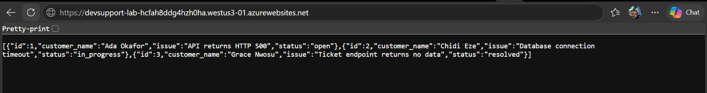
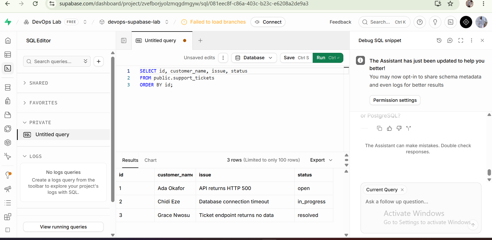
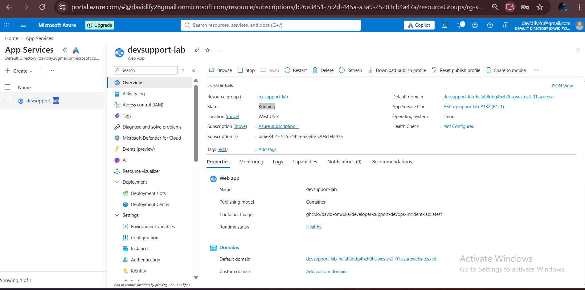
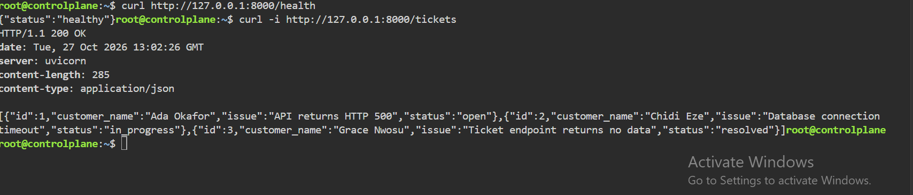
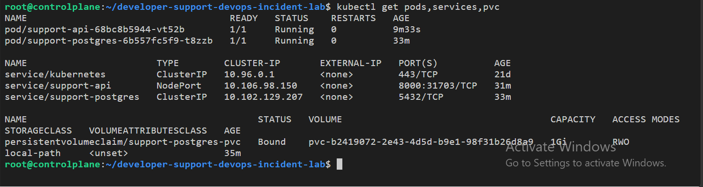
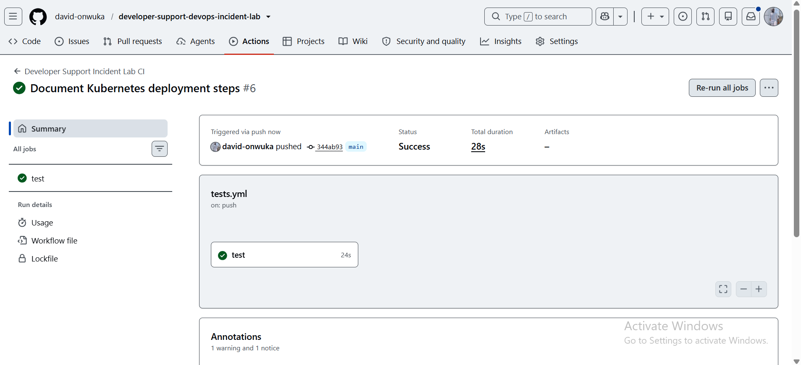
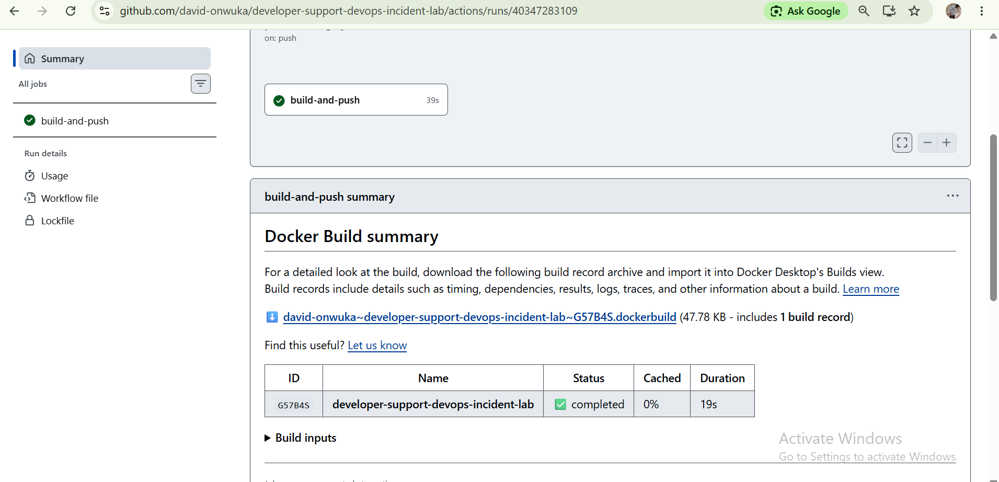

# Developer Support & DevOps Incident Lab

[](https://github.com/david-onwuka/developer-support-devops-incident-lab/actions/workflows/tests.yml)
[](https://github.com/david-onwuka/developer-support-devops-incident-lab/actions/workflows/publish-image.yml)

A hands-on lab for investigating application issues, troubleshooting database connectivity, deploying containerized services, and documenting incident recovery.

A FastAPI application backed by PostgreSQL, run with Docker Compose, tested with pytest, built and published by GitHub Actions to GitHub Container Registry (GHCR), deployed to Kubernetes, and then deployed to Azure App Service with a Supabase PostgreSQL database.

**Container image:** `ghcr.io/david-onwuka/developer-support-devops-incident-lab:latest`

## Proof at a glance

- API deployed to the public internet on Azure App Service. `/`, `/health` and `/tickets` all returned HTTP 200, and `/tickets` returned three records from Supabase PostgreSQL.
- Earlier deployment to Kubernetes with a PersistentVolumeClaim for PostgreSQL storage, verified as `Bound`.
- Database connection string supplied through configuration (a Kubernetes Secret and an Azure application setting), not hardcoded.
- Two GitHub Actions workflows, one for tests and one for publishing the image to GHCR.
- Two documented incidents: a simulated PostgreSQL outage in Kubernetes, and a real `DATABASE_URL` misconfiguration on Azure, diagnosed from application logs.



> **Note:** Neither deployment stays up permanently. The Kubernetes deployment ran in a Killercoda lab environment that has expired. The Azure deployment runs on free credits that expire on 25 November 2026, after which the live URL will stop working. The manifests, workflows and screenshots in this repository are the evidence of both deployments.

## Why I built this

I wanted to bring application support and DevOps operations together in one project. Instead of only writing an API, I worked through running a service, checking its dependencies, testing its behaviour, deploying it to two different platforms, and documenting how to investigate and recover from infrastructure problems.

## Technology stack

- **Python, FastAPI:** REST API
- **PostgreSQL:** relational storage for support tickets (in-cluster in Kubernetes, Supabase in the cloud)
- **Docker, Docker Compose:** containerization and local environment
- **pytest:** automated tests
- **GitHub Actions:** test and image publishing workflows
- **GHCR:** image storage and distribution
- **Kubernetes:** deployment, service discovery, persistent storage
- **Azure App Service (Linux containers):** cloud hosting
- **Supabase PostgreSQL:** hosted database, connected through the Session Pooler with SSL

## Architecture

```text
Client
  |
  v
FastAPI Application
  |
  | SQL connection
  v
PostgreSQL Database
  |
  v
Support Ticket Records
```

Build and delivery pipeline:

```text
GitHub Repository
       |
       v
GitHub Actions
       |
       +----> Run automated tests
       |
       +----> Build and publish image
                       |
                       v
                     GHCR
                    /     \
                   v       v
       Kubernetes Cluster   Azure App Service
         /           \             |
        v             v            v
  FastAPI API    PostgreSQL   FastAPI API
                      |            |
                      v            v
              PersistentVolume   Supabase PostgreSQL
```

## Getting started

### Prerequisites

- Git
- Python
- Docker and Docker Compose
- For the Kubernetes deployment: a cluster and `kubectl`

### Run with Docker Compose

```bash
git clone https://github.com/david-onwuka/developer-support-devops-incident-lab.git
cd developer-support-devops-incident-lab
docker compose up --build -d
docker compose ps
```

View logs when investigating a problem:

```bash
docker compose logs api
docker compose logs postgres
```

Stop the environment:

```bash
docker compose down
```

### Run the tests

```bash
python3 -m venv .venv
source .venv/bin/activate
pip install -r requirements.txt
python -m pytest -v
```

## API endpoints

| Method | Endpoint | Purpose |
|---|---|---|
| GET | `/` | Returns service status information. |
| GET | `/health` | Checks application health. |
| GET | `/tickets` | Retrieves support tickets from the database. |

```bash
curl -i http://localhost:8000/health
curl -i http://localhost:8000/tickets
```

`/health` returns HTTP 200 with `{"status": "healthy"}`. `/tickets` returns HTTP 200 with three sample tickets, in both the Kubernetes and Azure deployments:

| ID | Customer | Issue | Status |
|---:|---|---|---|
| 1 | Ada Okafor | API returns HTTP 500 | open |
| 2 | Chidi Eze | Database connection timeout | in_progress |
| 3 | Grace Nwosu | Ticket endpoint returns no data | resolved |

These are the kinds of issues a support engineer investigates.

## CI/CD

Two workflows live in `.github/workflows/`:

- `tests.yml` runs the pytest suite.
- `publish-image.yml` builds the application image and publishes it to GHCR.

Keeping them separate means validating a change and distributing an image are independent steps. Both Kubernetes and Azure pull the same published image.

## Kubernetes deployment

Manifests and deployment instructions are in [`k8s/`](k8s/README.md). The deployment includes:

- A PostgreSQL Deployment and a FastAPI Deployment.
- A PostgreSQL Service (`support-postgres`) for in-cluster connectivity.
- An API Service exposed through NodePort `31703` in the lab configuration.
- A PersistentVolumeClaim (`support-postgres-pvc`, 1 GiB) for PostgreSQL storage.
- A ConfigMap for database initialization.
- A Secret holding the database connection configuration. The credentials are demonstration credentials, not production ones.

After applying the manifests, I checked resource status, confirmed both pods were running, and verified the endpoints. To test from a local terminal:

```bash
kubectl port-forward service/support-api 8000:8000
curl -i http://localhost:8000/health
curl -i http://localhost:8000/tickets
```

Keep port forwarding running while you make the requests. Stop it with `Ctrl+C`.

## Cloud deployment: Azure App Service and Supabase

I then deployed the same container image to Azure App Service on Linux and connected it to a PostgreSQL database hosted on Supabase.

- **Request flow:** Client → Azure App Service → FastAPI → Supabase PostgreSQL
- **Image:** pulled from GHCR (`ghcr.io/david-onwuka/developer-support-devops-incident-lab:latest`)
- **Resource group / Web App:** `rg-support-lab` / `devsupport-lab`
- **Database:** a separate `public.support_tickets` table created in an existing Supabase project, with three sample tickets inserted and checked in the Supabase SQL Editor
- **Connectivity:** Supabase Session Pooler with SSL
- **Configuration:** the connection string is set in the `DATABASE_URL` Azure application setting, not in the source code

After deployment, `/`, `/health` and `/tickets` all returned HTTP 200, and `/tickets` returned the three records from Supabase.

### Incident: `/tickets` failing on Azure

**Problem.** After deployment, the `/tickets` endpoint failed when retrieving records from PostgreSQL.

**Investigation.**

1. Called the endpoint and confirmed it was failing.
2. Read the Azure App Service application logs.
3. Found this error:

```text
psycopg.ProgrammingError: missing "=" after "```text" in connection info string
```

**Root cause.** The `DATABASE_URL` application setting contained stray markdown code-fence text (`` ```text ``) from when the value was pasted. Because the value did not begin with a valid connection URL, the PostgreSQL driver tried to read it as `key=value` pairs and failed on the first token.

**Resolution.** Replaced the setting with a correctly formatted connection string, URL-encoding characters where required.

**Verification.** Retested the deployed endpoint and confirmed `/tickets` returned all three expected records.

The workflow was: reproduce the failure, read the logs, identify the root cause, correct the configuration, verify recovery.

### Security notes

- Credentials live in Azure application settings, never in the repository.
- The database connection uses SSL.
- Credentials that have been exposed should be rotated and the application setting updated.

## PostgreSQL outage and recovery exercise (Kubernetes)

I simulated a database outage by scaling the PostgreSQL Deployment to zero replicas, then restored it:

```bash
kubectl scale deployment/support-postgres --replicas=0
kubectl scale deployment/support-postgres --replicas=1
```

After restoring, I confirmed the workloads were running, restarted port forwarding, and verified `/tickets` returned HTTP 200 with all three sample tickets.

Full write-up: [PostgreSQL Outage and Recovery Report](incidents/postgres-outage-recovery.md)

## Evidence

### Azure and Supabase

**Azure tickets API.** The deployed API returning the three support ticket records.


**Supabase query results.** The same three records in the Supabase SQL Editor, confirming the data comes from PostgreSQL.



**Azure App Service overview.** The deployed Azure Web App and its reported status.



### Kubernetes and CI/CD

**API health and ticket retrieval.** Health and ticket endpoint responses from the Kubernetes deployment.



**Kubernetes resources.** Application and database workloads, Services, and the bound PersistentVolumeClaim.



**Automated tests.** A successful GitHub Actions test run.



**Image publishing.** A successful GitHub Actions run publishing the image to GHCR.



## Repository structure

```text
developer-support-devops-incident-lab/
├── .github/workflows/   # tests.yml, publish-image.yml
├── app/                 # FastAPI application
├── docs/screenshots/    # Deployment and CI/CD evidence
├── incidents/           # Incident reports
├── k8s/                 # Kubernetes manifests and deployment guide
├── tests/               # Automated tests
├── Dockerfile
├── docker-compose.yml
├── init.sql             # Database initialization
├── requirements.txt
└── README.md
```

## Future improvements

- Add readiness and liveness probes to the Kubernetes Deployments.
- Add resource requests and limits.
- Tag images with the commit SHA instead of relying on `latest`.
- Add integration tests for database-unavailable and missing-table scenarios.
- Add a database backup and restore exercise.
- Add structured logs and metrics.
- Add a Secret creation example that avoids committing real credentials.

## Author

**Eme David Onwuka**

Technical Support | Developer Support | DevOps | Infrastructure & Databases

- GitHub: [david-onwuka](https://github.com/david-onwuka)
